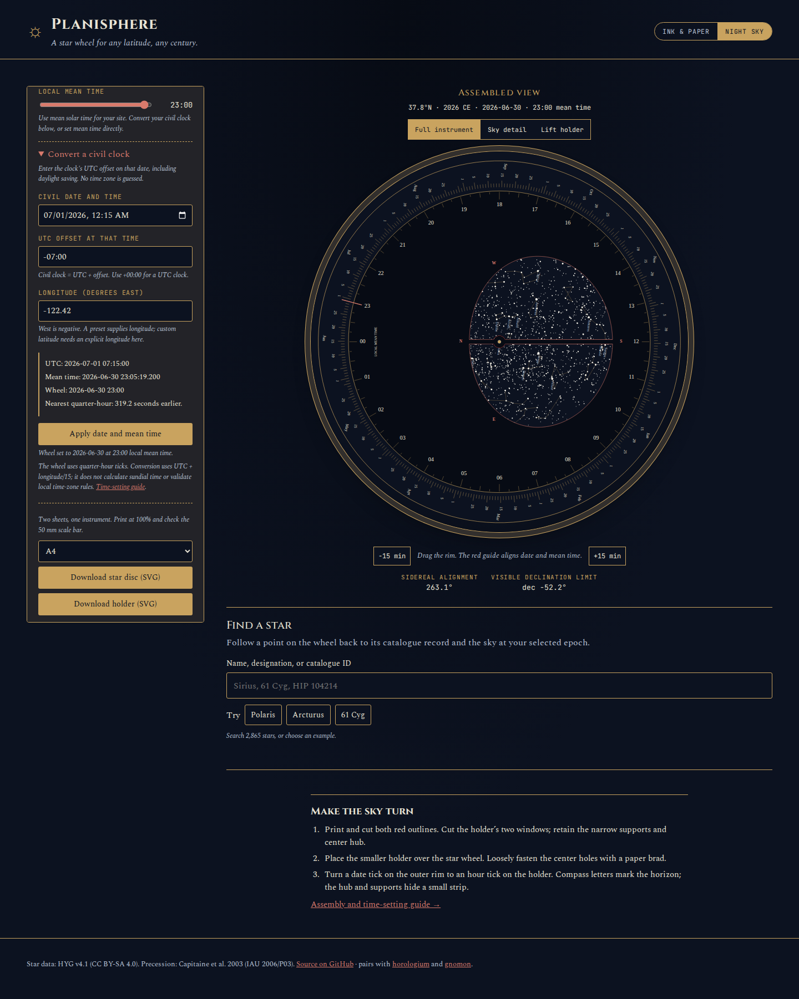

# Set the wheel from a civil clock

Source-checkout workflow, checked 2026-10-12. The hosted app has not been updated.

The existing wheel accepts **local mean time**. Previously its controls directed
the user to calculate the conversion externally. Entering a civil clock directly
could set both the wrong hour and the wrong date. The [before capture](before.json)
records that manual-entry scenario against source
`efa33746b52f0d77b98af29604fe18f06a1082b0`; the original UI explicitly warned that
the time control was for mean time.

**Convert a civil clock** now takes the civil date/time, its explicit UTC offset
and longitude. It previews UTC, unrounded mean time and the nearest quarter-hour.
Apply changes the wheel's date and time together. The annual scale regenerates
when the resulting year changes. Draft or invalid conversion inputs leave the
current instrument and downloads intact. No additional dependency or network
service is used.



## Concrete cases

These are controlled calendar inputs, not recorded observing sessions.

| Civil clock | UTC offset | Longitude, east positive | Unrounded mean clock | Applied wheel setting |
| --- | --- | ---: | --- | --- |
| 2026-07-01 00:15 | -07:00 | -122.42 | 2026-06-30 23:05:19.2 | 2026-06-30 23:00 |
| 2026-01-01 00:05 | +14:00 | -157.4 | 2025-12-30 23:35:24 | 2025-12-30 23:30 |
| 2026-12-31 23:59 | +00:00 | 0 | 2026-12-31 23:59:00 | 2027-01-01 00:00 |

```text
civil date/time + explicit offset
              |
             UTC + east-positive longitude / 15 hours
              |
        local mean date/time
              |
   nearest quarter-hour, ties later
              |
      Apply date and mean time
              |
   aligned wheel + annual print scale
```

The second case matters at the date line: longitude and civil offset need not
have the same sign. Rounding the hour alone would lose the last case's New Year
transition. The time-zone offset is supplied by the user, never inferred from
the device, a latitude or a place name. A city preset fills longitude; choosing
custom latitude clears that preset, and subsequent custom latitude edits preserve
an explicitly entered longitude.

## Independent arithmetic and browser evidence

[Eighteen retained cases](oracle.json) cover leap days, century years, years below
100, fractional UTC offsets, both longitude limits, the date line and half-quarter
ties before/after the Unix epoch. `check_oracle.py` recomputes the results using
Python's calendar arithmetic and decimal longitude calculation. It reads only
the three input fields to compute expected outputs; TypeScript results are
checked against those retained expectations.

[Browser evidence](browser.json) contains four offline workflows: Chromium and
Firefox at 1440px/night and 375px/ink. Each applies all three cases above by keyboard,
checks the visible controls and actual date-tick/hour-tick alignment, then downloads
the disc and holder. All 24 SVG downloads parse successfully at A4 dimensions;
each disc contains the correct annual scale and selected date. The maximum
allowed alignment discrepancy in this check is 0.002 degrees, accounting for
serialized SVG coordinates. That is a drawing consistency check, not sky accuracy.

The actual date-line downloads are retained as [star disc](../../docs/assets/clock-conversion/dateline-disc.svg)
and [holder](../../docs/assets/clock-conversion/dateline-holder.svg). Their scale
is **2025**, while the stellar epoch stays **2026**. Screenshots of all four browser
workflows were inspected. The selected converter state had no axe violations,
page overflow, page errors, external requests or CSP violations. Separate browser
regressions cover invalid drafts, custom-longitude recovery and subsequent manual
time changes.

The browser receipt also byte-compares all 37 served build files with local
`dist/`. It records end-to-end Apply timings, including browser automation and
rendering overhead; these are observations on a 14-vCPU WSL2 machine, not a
portable performance guarantee.

## Clean build

[The verification receipt](verification.json) records a fresh archive of
implementation commit `03e75dd26d9d0eebb9b1f0a689b50ac439deaf69`, installed with
Node 24.21.0. Lint, types, 502 unit/numerical checks, production build, the
independent Python oracle and all 76 Chromium/Firefox browser checks passed.
All 173 tracked archive files remained unchanged. All 37 rebuilt app files
match the served files exercised in the retained offline browser workflows.

The twelve measured Apply interactions had a median 54.9 ms including browser
automation, event handling and rendering. The receipt retains each observation.
No registry release or hosted deployment accompanied this source work.

## Reproduce

```sh
npm ci
python3 studies/clock-conversion/check_oracle.py
npm run test -- tests/clockConversion.test.ts
npm run build
npm run test:browser
```

To repeat the retained workflow, serve `dist/` with
`npm run preview -- --host 127.0.0.1 --port 4217 --strictPort`, then run in another terminal:

```sh
node studies/clock-conversion/browser.mjs http://127.0.0.1:4217/planisphere/ /tmp/planisphere-clock-evidence
```

This writes actual downloads, four screenshots and `browser.json`. It needs the
Playwright Chromium/Firefox engines. The source checkout supplies the browser
dependencies; no external model, private dataset or paid service is involved.

## Boundaries and references

Conversion uses `civil - UTC offset + longitude / 15 hours`. In NOAA's
[solar-position equations](https://gml.noaa.gov/grad/solcalc/solareqns.PDF), the
longitude/zone correction has the same signs; the equation-of-time term belongs
to apparent solar time and is deliberately absent from this mean-time helper.
[USNO distinguishes UT1 and UTC](https://aa.usno.navy.mil/faq/UT): this helper
approximates the Earth-rotation time scale with the civil one.

The helper accepts explicit offsets between -14:00 and +14:00 with minute
precision, and Gregorian years 0001–9999. A conversion outside that calendar
range is rejected. It does not determine whether the entered offset was in force,
resolve skipped/repeated local times, or accept historical second-level offsets
and leap seconds. Mean time is rounded to the wheel's existing 15-minute ticks.
The annual ring still samples the mean Sun at 00:00 UTC and has the existing
paper-chart approximations. A physical assembly and observation remain unverified.
