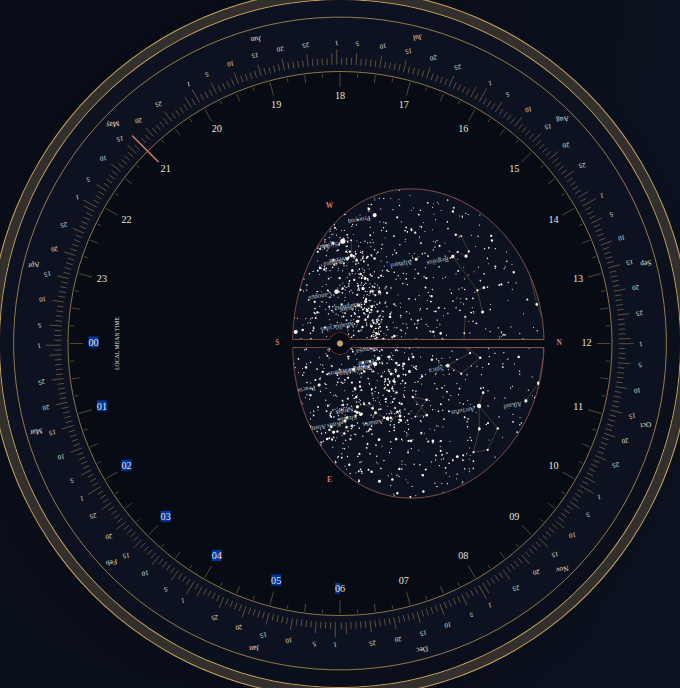
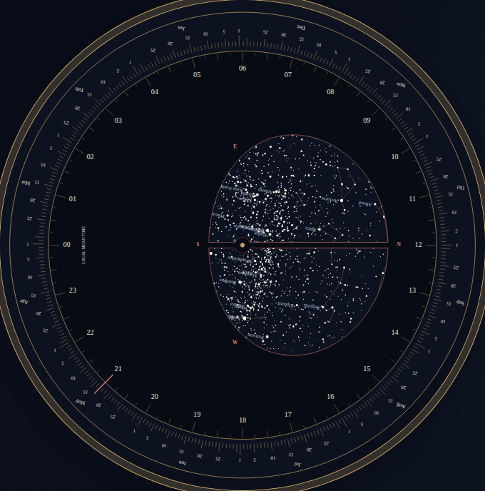

# Southern sky handedness

The south-pole charts at source `ba3f1d4` reflected constellation shapes and
compass directions. The list of visible stars was still correct. A printed
instrument therefore passed horizon tests while showing a sky that cannot be
matched by turning the paper.

Both southern pieces must be regenerated: the wheel, date scale, hour scale
and compass labels all change together. This correction is local source work;
it has not been deployed or released to a registry.

| Original assembled preview | Corrected assembled preview |
| --- | --- |
|  |  |

These are production-browser screenshots at 33.9 S, epoch J2000, Gregorian
2026-05-17, 21:00 local mean time. The original and corrected actual downloads
are retained as `before/chromium-1440-{disc,holder}.svg` and
`after/chromium-1440-{disc,holder}.svg`. Mobile screenshots and browser receipts
are in the same directories.

## Independent construction

`oracle.py` uses only Python's standard library and catalogue positions. It
forms a star direction in local East/North/Up coordinates, an elevated-pole
camera, and a right/up camera basis. The cross product of those camera basis
vectors points toward the viewer: this looks out from inside the sky rather
than looking down onto a globe. Angular distance from the camera pole sets
the equidistant radius; dot products with the camera basis set the angle.
There are no imports of Planisphere's geometry.

For hemisphere sign `s` (+1 north, -1 south), the result requires:

| Quantity, y-up artwork | Formula |
| --- | --- |
| Star angle on wheel | `-s * RA` |
| Wheel rotation | `s * LST` |
| Star angle in holder | `s * (LST - RA)` |
| Date angle | `-s * RA_meanSun` |
| Hour angle on scale | `s * (hour - 12) * 15` |

The original code changed only radial distance at the south pole. A north-pole
angular convention at the other pole reverses orientation. The horizon uses
`cos(H)`, so that reflection does not change its visibility decisions. New
checks cover both orientation and the actual disc-plus-rotation pipeline.

As a separate visual cross-check, the Astronomical Society of Southern Africa's
[Southern Star Wheel v14](https://assa.saao.ac.za/wp-content/uploads/sites/23/2023/12/southern-star-wheel-v14.pdf)
places increasing clock hours clockwise on the printed southern holder, as does
the corrected output. Its [instructions](https://assa.saao.ac.za/how-to-observe/getting-started/planisphere/)
provide an independent, usable southern instrument. That third-party artwork
is not redistributed here and is not used as a numerical oracle.

## Measured exported geometry

The sweep uses 94 catalogue stars brighter than magnitude 2.5, nine latitudes
(-89, -65, -33.9, -0.1, 0, 0.1, 32.5, 65, 89), and four sidereal alignments.
Epoch 2000 removes motion/precession as confounders. The exporter omits dots
outside each physical sky disc; the comparison measures all remaining dots
from the emitted SVG coordinates, rotated into the holder frame. This gives
2,668 printable star positions from 3,384 candidate projections.

| Measurement | Original | Corrected |
| --- | ---: | ---: |
| Positions beyond 0.002 mm tolerance | 1,164 / 2,668 | 0 / 2,668 |
| Maximum position difference | 118.2547 mm | 0.000701 mm |
| Compass orientations reversed | 16 / 36 | 0 / 36 |
| Acrux/Mimosa/Gacrux signed triangle area | +1.22512 mm2 | -1.22512 mm2 |
| Southern mean time after the same 90-degree drag from 21:00 | 15:00 | 03:00 |

The correct sign of the Southern Cross triangle is independently supplied by
the ENU camera. Signed area is unchanged by rotation; a reflected triangle
cannot be repaired by changing time. North-disc and north-holder SVGs from
the same replay were byte-identical before and after. The residual corrected
position difference is consistent with three-decimal SVG rounding. This is
projection agreement, not an observational or fabrication accuracy claim.

`before/replay.json` and `after/replay.json` retain every camera's counts and
errors. The catalogue SHA-256 is recorded in each. The small committed fixture
in `tests/fixtures/sky-handedness.oracle.json` covers seven familiar stars at
all nine latitudes; `oracle.py` regenerates it.

Full clean-install and browser results: [verification report](../../docs/verification-sky-handedness-2026-10-18.md).

## Reproduce

From the repository root, after `npm ci`:

```sh
python studies/sky-handedness/oracle.py
node studies/sky-handedness/replay.mjs studies/sky-handedness/after
npm run build
```

The oracle's larger working data lives in ignored `cache/`. To replay the
original source, extract `git archive ba3f1d4` into a temporary directory and
pass that directory as the replay command's second argument. The current
script loads that source through Vite without requiring its own node_modules.

Serve each production build with `npm run preview -- --port 4252 --strictPort`,
then run:

```sh
node studies/sky-handedness/browser.mjs http://localhost:4252/planisphere/ studies/sky-handedness/after overhead
```

The browser study checks Chromium and Firefox, 1440 and 375 pixels, after
switching the context offline. It measures actual compass/star coordinates,
downloads and parses both print pieces, and uses a real pointer drag.
All four corrected workflows completed without page exceptions, CSP violations,
external requests or horizontal overflow. Eight downloads were measured per
build; one identical pair per build is retained to avoid duplicate artifacts.
Use `reflected` instead of `overhead` against the original build to reproduce
the incorrect output rather than asserting the corrected behavior.

`print-example.mjs URL OUTPUT_DIR` regenerates the Letter southern downloads
and reconstructs their opaque assembly from their actual paths. The repository's
[example print files](../../docs/assembly.md#example-print-files) now use those
corrected pieces. All screenshots and that assembled proof were visually
reviewed. Physical paper, fastener, printer and cutter validation remains open.
